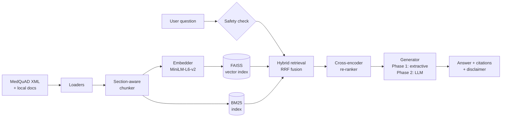
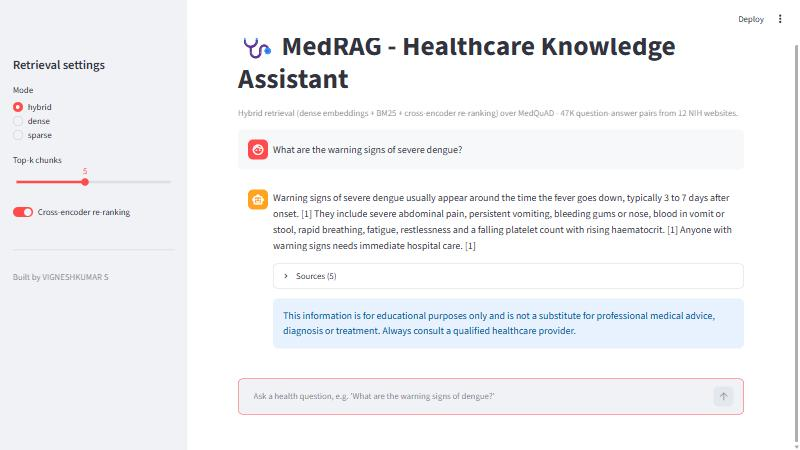

# 🩺 MedRAG — Healthcare Retrieval-Augmented Generation

A healthcare question-answering assistant built on **Retrieval-Augmented Generation (RAG)**.
MedRAG indexes **17,900+ expert-written medical answers from 12 NIH websites (MedQuAD)** and answers
health questions **grounded in cited, linked sources**, with built-in healthcare safety guardrails.
Retrieval quality is measured on the **TREC 2017 LiveQA-Med benchmark**, using real consumer health
questions with expert relevance judgments.

> **Author:** VIGNESHKUMAR S · [github.com/Vicky26072002](https://github.com/Vicky26072002)
> **Status:** Phase 1 (Retrieval) ✅ · Phase 2 (LLM generation) 🚧

---

## ✨ Features

- **Real medical knowledge base:** [MedQuAD](https://github.com/abachaa/MedQuAD) answers from NIH sources (GARD, Genetics Home Reference, NIDDK, NINDS, NHLBI, CDC, Cancer.gov, MedlinePlus…), plus your own `.md` / `.txt` / `.pdf` documents
- **Section-aware chunking:** each chunk keeps its question/heading as context, with configurable size and overlap
- **Dense retrieval:** `sentence-transformers` embeddings (`all-MiniLM-L6-v2`) in a **FAISS** inner-product index
- **Sparse retrieval:** a vectorised **BM25** (SciPy sparse matrix, ~1 ms/query) for exact medical terms (drug names, genes, lab values)
- **Hybrid search:** dense and sparse results fused with **Reciprocal Rank Fusion (RRF)**
- **Cross-encoder re-ranking:** `ms-marco-MiniLM-L-6-v2` re-scores the top 30 candidates for precision
- **Cited answers:** the most relevant sentences are chosen by the cross-encoder, using document and section context, then tagged `[n]` and linked to their NIH source URL
- **Healthcare guardrails:** emergency red-flag detection (chest pain, stroke signs, overdose, suicidal ideation…) and a medical disclaimer on every answer
- **Benchmark evaluation:** Hit@1, Hit@5, MRR@10 and nDCG@10 on TREC LiveQA-Med with graded expert judgments
- **Interfaces:** CLI, **FastAPI** REST API, and **Streamlit** chat UI
- **Tested:** `pytest` suite that runs fully offline

## 🏗️ Architecture



## 📊 Results



**Benchmark:** TREC 2017 LiveQA-Med: 104 real consumer health questions sent to the U.S. National Library of
Medicine, with 2,479 MedQuAD answers judged by experts (1-Incorrect … 4-Excellent).
**Index:** 17,913 answers → 42,601 chunks. Scoring is at the answer level. An answer is relevant when it is judged
*Incomplete* or *Excellent* (78 questions have at least one); nDCG uses the graded judgments.

| Retriever | Hit@1 | Hit@5 | MRR@10 | nDCG@10 | Latency / query (CPU) |
|---|---|---|---|---|---|
| BM25 (sparse) | 0.359 | 0.628 | 0.474 | 0.413 | 1 ms |
| Dense (MiniLM + FAISS) | 0.577 | **0.833** | 0.679 | 0.553 | 44 ms |
| Hybrid (RRF) | 0.577 | 0.821 | 0.682 | 0.562 | 45 ms |
| **Hybrid + cross-encoder re-rank** | **0.577** | 0.821 | **0.686** | **0.607** | 1.7 s |

Findings:
- **Dense retrieval beats BM25 by +34% nDCG@10** on real consumer questions, which are informal, misspelled, and use lay terms.
- **Cross-encoder re-ranking adds +8% nDCG@10** over hybrid (0.562 → 0.607) by placing the *best* answers higher. With the looser "Related or better" threshold (96 questions), it gives the best Hit@5 at **0.885**.
- On NIST's cleaned-up *paraphrased* questions, hybrid without re-ranking scores best (nDCG@10 0.581). Re-ranking helps most on messy real-world input.
- **Vectorised sparse-matrix BM25** cut keyword search from ~550 ms to ~1 ms per query (≈500× faster than `rank_bm25`), so hybrid search costs almost the same as dense search alone.
- With 78 questions, one question changes Hit@1 by 0.013, so small differences between rows are not significant.

Reproduce with `python -m medrag eval` (add `--paraphrase` or `--min-grade 1` for the variants).
Raw numbers are in [results/](results/).

## 📚 Datasets

| Dataset | Use | Size | License |
|---|---|---|---|
| [MedQuAD](https://github.com/abachaa/MedQuAD) | Knowledge base | 47,457 QA pairs from 12 NIH websites; 16,407 have answers (the authors removed 3 MedlinePlus subsets for copyright) | CC BY 4.0 |
| MedQuAD judged answers (`QA-TestSet-LiveQA-Med-Qrels-2479-Answers`) | Knowledge base + relevance labels | 2,479 answers judged 1-Incorrect … 4-Excellent | CC BY 4.0 |
| [TREC 2017 LiveQA-Med test questions](https://github.com/abachaa/LiveQA_MedicalTask_TREC2017) | Benchmark queries | 104 real consumer health questions sent to the U.S. National Library of Medicine | see repo |
| `data/raw/` | Demo documents | 5 short educational summaries (diabetes, hypertension, asthma, dengue, antibiotics) | MIT |

Datasets are **not committed** to this repo. `python -m medrag download` fetches them into `data/external/`.

## 📁 Project structure

```
healthcare-rag/
├── app/streamlit_app.py      # Chat UI
├── docs/                     # Screenshots
├── data/
│   ├── raw/                  # Local demo documents (add your own here)
│   ├── eval/qa.jsonl         # Small local retrieval test set
│   └── external/             # Downloaded datasets (git-ignored)
├── results/                  # Benchmark results (JSON)
├── src/medrag/
│   ├── config.py             # Settings from env / .env
│   ├── loaders.py            # .md / .txt / .pdf loading
│   ├── datasets.py           # MedQuAD + LiveQA download, parsing, benchmark
│   ├── chunking.py           # Section-aware chunking
│   ├── embeddings.py         # Sentence-Transformers + offline hashing embedder
│   ├── vector_store.py       # FAISS (or NumPy) persistent store
│   ├── bm25.py               # Vectorised sparse-matrix BM25
│   ├── retriever.py          # Dense + BM25 hybrid retrieval with RRF + re-ranking
│   ├── reranker.py           # Cross-encoder re-ranker
│   ├── generator.py          # Extractive generator, LLM prompt (Phase 2)
│   ├── safety.py             # Emergency detection + disclaimer
│   ├── pipeline.py           # End-to-end RAG pipeline
│   ├── evaluation.py         # Hit@k, MRR, nDCG
│   ├── api.py                # FastAPI service
│   └── cli.py                # Command-line interface
├── tests/                    # pytest suite
├── requirements.txt
└── pyproject.toml
```

## 🚀 Quickstart

```bash
python -m venv .venv
.venv\Scripts\activate          # Windows  (Linux/macOS: source .venv/bin/activate)
pip install -r requirements.txt
pip install -e .
```

```bash
python -m medrag download       # 1. fetch MedQuAD + LiveQA (~30 MB)
python -m medrag ingest         # 2. chunk, embed and index (~25 min on CPU)
python -m medrag eval --output results/liveqa_benchmark.json   # 3. benchmark
```

### Ask questions
```bash
python -m medrag ask "What are the symptoms of Marfan syndrome?"
python -m medrag ask "how is hepatitis C spread" --mode dense --top-k 3 --no-rerank
```

### REST API
```bash
python -m medrag serve
```
Open http://127.0.0.1:8000/docs, or:
```bash
curl -X POST http://127.0.0.1:8000/ask -H "Content-Type: application/json" -d "{\"question\": \"How is asthma treated?\"}"
```

### Chat UI
```bash
streamlit run app/streamlit_app.py
```

### Tests
```bash
pytest
```

## ⚙️ Configuration

All settings come from environment variables (see [.env.example](.env.example)):

| Variable | Default | Description |
|---|---|---|
| `MEDRAG_SOURCES` | `local,medquad` | Knowledge sources to index |
| `MEDRAG_EMBEDDING_BACKEND` | `sentence-transformers` | or `hashing` (offline) |
| `MEDRAG_EMBEDDING_MODEL` | `sentence-transformers/all-MiniLM-L6-v2` | Any Sentence-Transformers model |
| `MEDRAG_CHUNK_SIZE` / `MEDRAG_CHUNK_OVERLAP` | `800` / `120` | Chunking (characters) |
| `MEDRAG_TOP_K` | `5` | Chunks returned |
| `MEDRAG_RETRIEVAL_MODE` | `hybrid` | `hybrid`, `dense`, `sparse` |
| `MEDRAG_RERANK` | `true` | Cross-encoder re-ranking |
| `MEDRAG_RERANKER_MODEL` | `cross-encoder/ms-marco-MiniLM-L-6-v2` | Re-ranker model |

## 🗺️ Roadmap

- [x] **Phase 1 — RAG retrieval:** ingestion, chunking, embeddings, FAISS, BM25, hybrid RRF, cross-encoder re-ranking, benchmark evaluation, API, UI
- [ ] **Phase 2 — LLM generation:** grounded answer synthesis with citations (`generator.LLMGenerator`, prompt in `build_prompt`)
- [ ] Answer faithfulness evaluation (groundedness / hallucination checks)
- [ ] Biomedical embedding models (e.g. PubMedBERT-based) comparison
- [ ] Docker deployment

## ⚠️ Disclaimer

MedRAG is an educational project. It does not provide medical advice, diagnosis or treatment. Always consult a qualified healthcare professional.

## 📖 Citation

The MedQuAD dataset and LiveQA judgments are from:

> Asma Ben Abacha and Dina Demner-Fushman. **A Question-Entailment Approach to Question Answering.** *BMC Bioinformatics*, 20(1):511, 2019. https://doi.org/10.1186/s12859-019-3119-4

> Asma Ben Abacha, Eugene Agichtein, Yuval Pinter, Dina Demner-Fushman. **Overview of the Medical Question Answering Task at TREC 2017 LiveQA.** *TREC 2017*.

## 📄 License

Code: [MIT](LICENSE) © 2026 VIGNESHKUMAR S. Datasets keep their original licenses (MedQuAD: CC BY 4.0).
